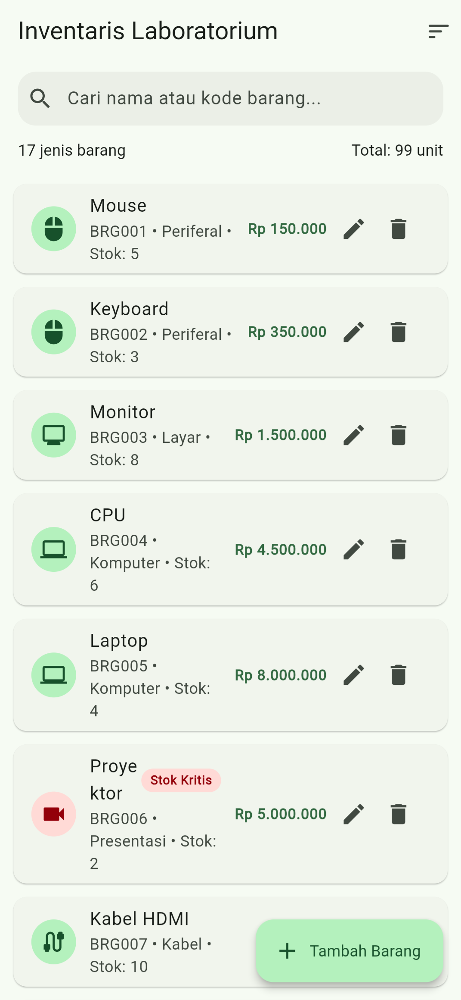
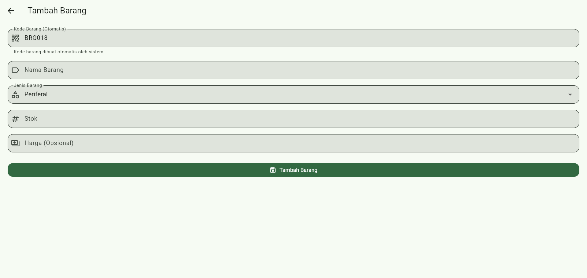

# Informatika 24 Mobile: Sistem Inventaris Laboratorium

Aplikasi pencatatan dan pengelolaan inventaris laboratorium komputer menggunakan Flutter dan Material 3.

---

## Antarmuka Aplikasi

<p align="center">
  
  &emsp;&emsp;
  
</p>

<p align="center">
  <em>Kiri: Katalog inventaris dan indikator stok. Kanan: Formulir input barang dan pembuatan kode otomatis.</em>
</p>

### 1. Katalog Inventaris
Halaman utama menampilkan daftar seluruh barang inventaris lengkap dengan kode, kategori, stok, harga, serta tombol aksi.

- Pencarian: filter daftar berdasarkan nama, kode barang (`BRGxxx`), atau kategori.
- Ringkasan: informasi total jenis barang dan akumulasi unit fisik yang terdata.
- Peringatan stok kritis: label peringatan otomatis untuk barang dengan stok $\le 2$ unit.
- Aksi cepat: tombol edit dan hapus langsung pada setiap kartu barang.

### 2. Formulir Barang
Formulir untuk menambah atau memperbarui data barang inventaris.

- Kode otomatis: sistem menentukan kode berikutnya (misal `BRG018`) berdasarkan data terakhir.
- Kategori barang: pilihan kategori standar lab (Periferal, Layar, Komputer, Presentasi, Kabel, Jaringan, Daya, Lainnya).
- Validasi input: memastikan nama minimal 3 karakter dan jumlah stok berupa angka non-negatif.
- Konfirmasi dan notifikasi: dialog konfirmasi sebelum menghapus barang serta banner notifikasi setelah perubahan disimpan.

---

## Fitur

- Operasi CRUD: tambah data barang baru, lihat detail, perbarui informasi, dan hapus barang.
- Pencarian instan: menyaring data secara langsung melalui bilah pencarian.
- Penanda stok kritis: penanda visual khusus untuk memudahkan pengadaan ulang aset lab yang menipis.
- Penyimpanan persisten: integrasi `SharedPreferences` (`PrefService`) agar data tetap tersimpan saat aplikasi ditutup.
- Tampilan Material 3: komponen UI standar Material 3 yang berjalan di Android, Web Chrome, dan Windows.
- Pengujian otomatis: dilengkapi unit test dan widget test dengan status lolos analisis (`flutter analyze`).

---

## Struktur Folder

```text
lib/
├── constants/         # Nilai konstan (warna, teks, batasan stok)
├── models/            # Model data (Barang, Kategori, Riwayat)
├── services/          # Layer penyimpanan lokal (PrefService / SharedPreferences)
├── theme/             # Tema aplikasi Material 3 (AppTheme)
├── utils/             # Validator input dan formatter teks
├── widgets/           # Komponen antarmuka mandiri (BarangCard, SearchBar, TopBanner, EmptyState)
├── screens/           # Layar tampilan (InventarisScreen, FormBarangScreen)
└── main.dart          # Entry point aplikasi
```

---

## Menjalankan Aplikasi

### Prasyarat
- Flutter SDK (versi $\ge$ 3.24)
- Google Chrome (untuk Web) atau C++ Desktop Development tools (untuk Windows)

### Langkah Menjalankan
```bash
# 1. Pasang dependensi
flutter pub get

# 2. Jalankan analisis kode dan pengujian
flutter analyze
flutter test

# 3. Jalankan aplikasi di Chrome
flutter run -d chrome

# Atau jalankan di Windows Desktop
flutter run -d windows
```

---

## Kontribusi

Bagi anggota tim yang mengerjakan tugas fitur:
1. Periksa panduan kontribusi dan pembagian tugas di [CONTRIBUTING.md](CONTRIBUTING.md).
2. Ikuti pedoman arsitektur modular dan aturan branching di [AGENTS.md](AGENTS.md).
3. Buat Pull Request menggunakan template di [.github/pull_request_template.md](.github/pull_request_template.md).
